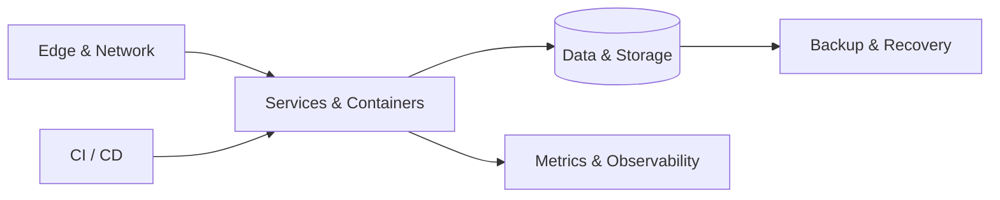

<!-- rui-Gg | Personal engineering profile -->

 

# RUI

**Cloud Infrastructure · Systems Engineering · Automation**

*Building reliable systems. Keeping room for possibility.*

 

---

### FOCUS

Cloud & Infrastructure&nbsp;&nbsp; / &nbsp;&nbsp;Linux & Networking&nbsp;&nbsp; / &nbsp;&nbsp;Containers & CI/CD&nbsp;&nbsp; / &nbsp;&nbsp;Observability

 

---

### SYSTEMS, SIMPLIFIED

### BEYOND THE TERMINAL

**Stay curious. Explore often. Enjoy the process.** ☀️

Good systems are built with care. A good life is built the same way.

