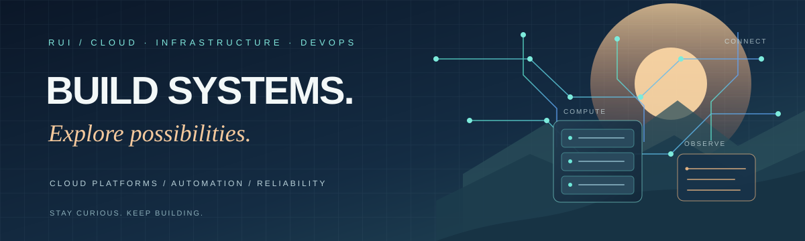
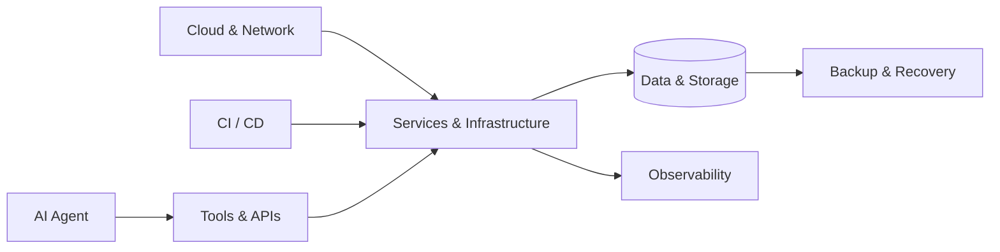

<!-- rui-Gg | Personal engineering profile -->

 

# RUI

**Cloud Infrastructure · AI Agents · Systems Engineering**

*Building reliable systems. Exploring intelligent ways to work.*

 

---

### FOCUS

Cloud & Infrastructure&nbsp;&nbsp; / &nbsp;&nbsp;AI Agents & Tooling&nbsp;&nbsp; / &nbsp;&nbsp;Automation & Reliability

 

 

Exploring agentic workflows, tool integration, and human-in-the-loop automation.

---

### SYSTEMS, SIMPLIFIED

### BEYOND THE TERMINAL

**Stay curious. Explore often. Enjoy the process.** ☀️

Good systems are built with care. A good life is built the same way.

