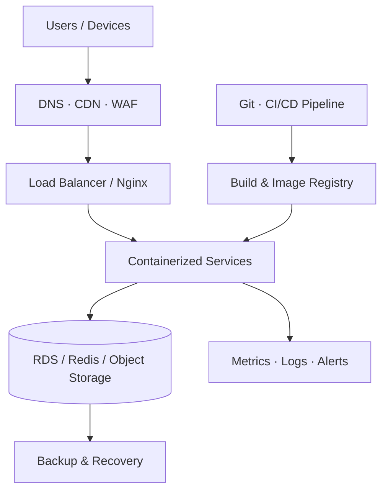

<!-- rui-Gg | GitHub profile README -->

 

# Hey, I'm Rui 👋

### Cloud Infrastructure · DevOps · Automation

**Building reliable systems, simplifying operations, and staying curious.**

 

---

## 👨‍💻 A little about me

I'm an infrastructure and operations engineer who enjoys making complex systems reliable, observable, and easier to operate.

My day-to-day interests sit around **cloud platforms, Linux, networking, containerized services, CI/CD, and monitoring**. I like practical engineering: understand the system, automate repeatable work, and make production less exciting for the right reasons.

Outside the terminal: good coffee, new places, photography, and keeping life curious. ☀️

## ⚙️ What I work with

### Cloud & Infrastructure

### Containers & Delivery

### Scripting & Data

### Observability

## 🧭 Things I enjoy building

| Focus | What it means |
|:--|:--|
| ☁️ **Cloud foundations** | Cloud resources, networking, storage, CDN, security boundaries |
| 🐧 **Systems & containers** | Linux operations, Docker workloads, reverse proxies, service reliability |
| 🚀 **Automation & delivery** | CI/CD pipelines, repeatable deployments, scripting away manual work |
| 📈 **Observability** | Metrics, dashboards, alerts, troubleshooting, and capacity awareness |

## 🏗️ How I think about infrastructure

A simplified view of the systems I like working on: clear entry points, isolated services, managed data, automated delivery, and visibility from end to end.

## 📊 GitHub at a glance

  
  

---

### BUILD SYSTEMS. EXPLORE POSSIBILITIES.

*Stay curious, keep learning, and leave things better than you found them.*

☀️ **Good systems. Good coffee. A life beyond the screen.**

 

[GitHub](https://github.com/rui-Gg)

